# QuadraDas - Locação de Quadras Esportivas

Site para reservar quadras esportivas, com **duas áreas separadas**:

| Área | Quem usa | Login | Endereço |
|------|----------|-------|----------|
| Site | Clientes | `/login` (e-mail ou telefone) | `http://localhost:8080/` |
| Painel | Administradores | `/admin/login` (e-mail) | `http://localhost:8080/admin` |

Cada login só aceita o seu tipo de conta (clientes e administradores ficam em tabelas diferentes).
Cliente tentando abrir `/admin/...` é mandado para o login de admin, e vice-versa.

## Como rodar (Tomcat 7)

Requisitos: JDK 8+ e Maven.

```
mvn clean package
mvn tomcat7:run
```
Abra http://localhost:8080/ . Também dá para pegar `target/locacaoquadra.war` e colocar na pasta
`webapps` de um Tomcat 7 (nesse caso o endereço fica `http://localhost:8080/locacaoquadra/`).

O banco (H2) é criado sozinho em `~/locacao_quadras_v1` (pasta do seu usuário) na primeira execução.
Para recomeçar do zero, pare o Tomcat e apague os arquivos `locacao_quadras_v1*`.

## Acessos de teste (criados automaticamente)

| Tipo | Login | Senha |
|------|-------|-------|
| Administrador | `admin@quadradas.com` | `admin123` |
| Cliente | `pedro@email.com` | `123456` |

**Troque a senha do admin** em Painel > Administradores. Para não criar quadras/cliente de exemplo,
ponha `CARREGAR_EXEMPLOS = false` em `config/DadosIniciais.java`.

## Funcionalidades

**Site (sem login):** página inicial com busca e categorias, lista de quadras (busca por nome/bairro/cidade,
modalidade, data e horário livres), detalhes da quadra com horários livres do dia, cadastro e login.

**Cliente logado:** realizar reserva (calendário, horários livres e total), minhas reservas (futuras e passadas),
cancelar reserva e editar perfil/senha.

**Administrador:** dashboard, quadras (ativar/desativar), horários (grade semanal Livre/Reservado/Bloqueado),
reservas (criar, ver, cancelar com devolução, excluir), usuários (ativar/desativar), modalidades e preços,
bloqueios de horário e administradores.

## Regras de negócio
- Preço por hora vem da modalidade: segunda a sexta x sábado e domingo.
- Um horário não pode ser reservado duas vezes na mesma data, nem em data/hora passada, nem se estiver bloqueado.
- Cancelamento pelo cliente: devolve 100% se faltarem 24h ou mais, senão 50%
  (constantes em `service/ReservaService.java`). O administrador define o valor devolvido manualmente.
- Quadra ou usuário inativos não aparecem/entram no site.

## Segurança
Senhas com BCrypt, proteção CSRF em todos os formulários, sessão nova a cada login, telas protegidas dentro de
`WEB-INF/views`, texto escapado nas telas. O console do H2 (`/console`) só abre para administrador logado; apague o bloco `H2Console` do `web.xml` em produção.

#locacaodequadra


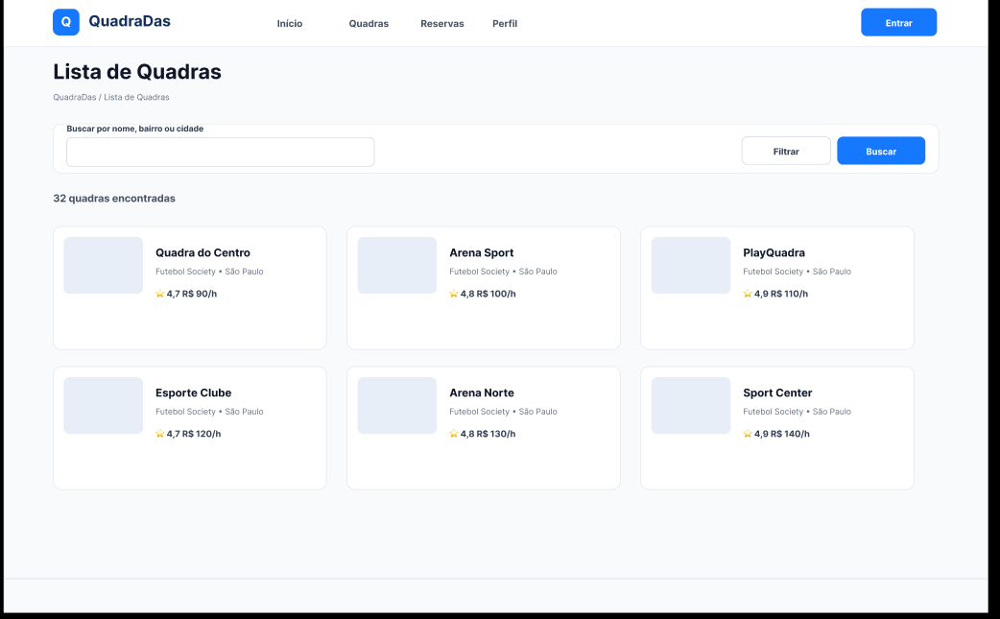
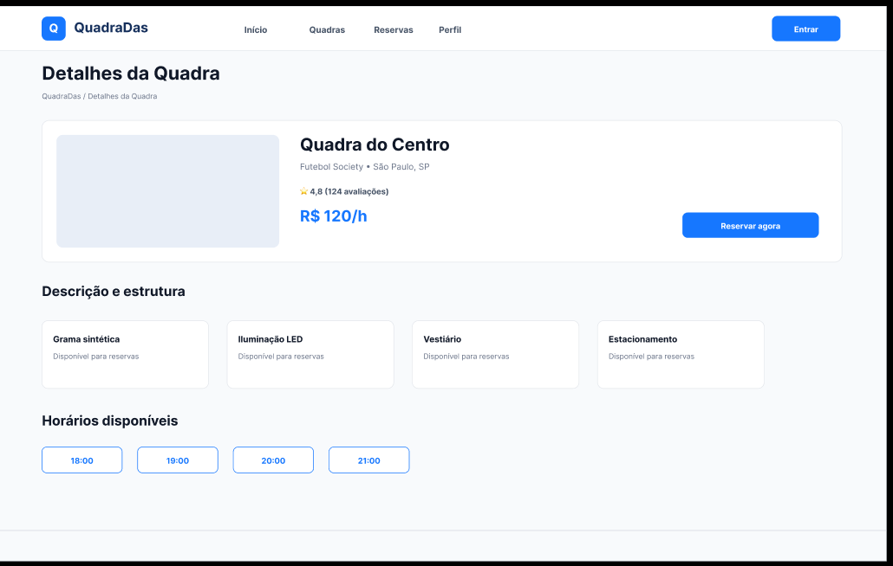
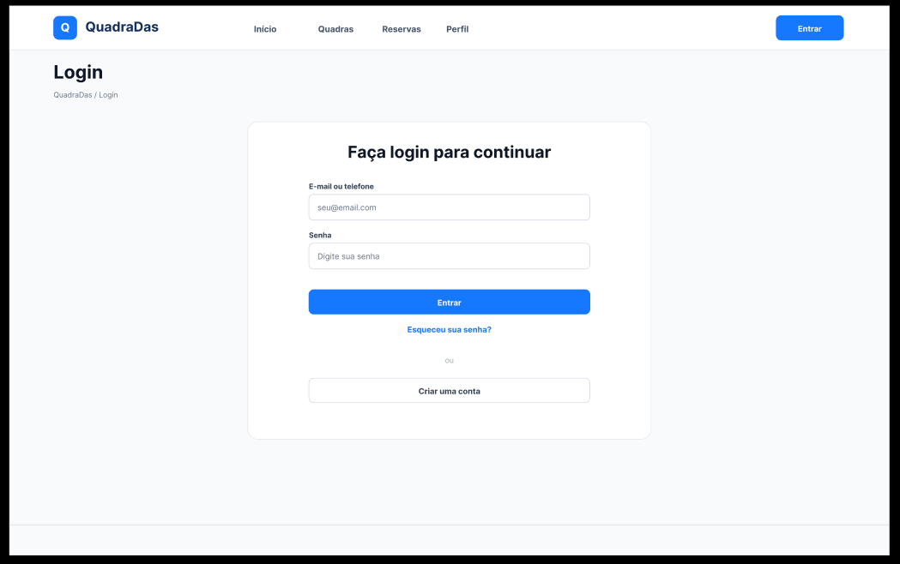
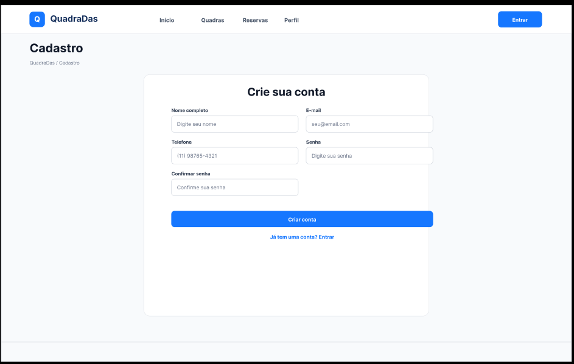
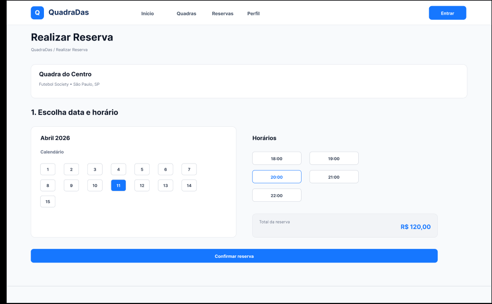
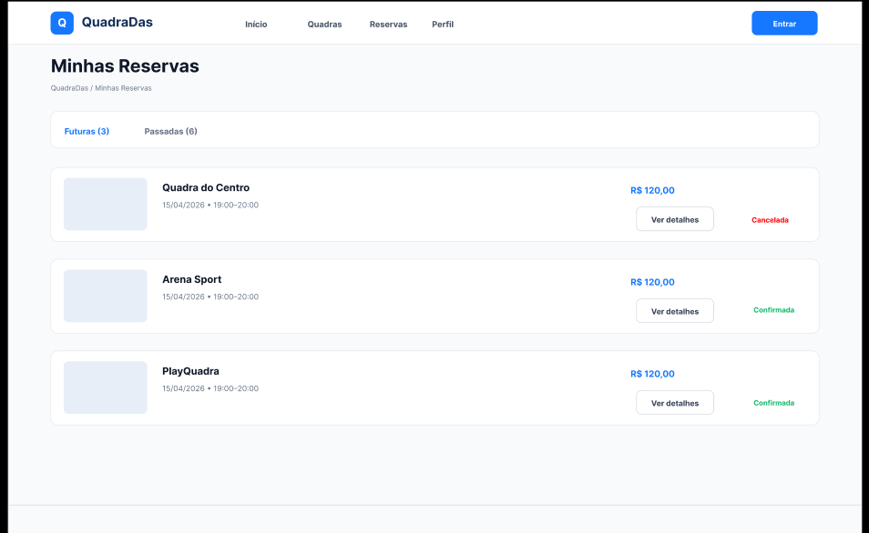
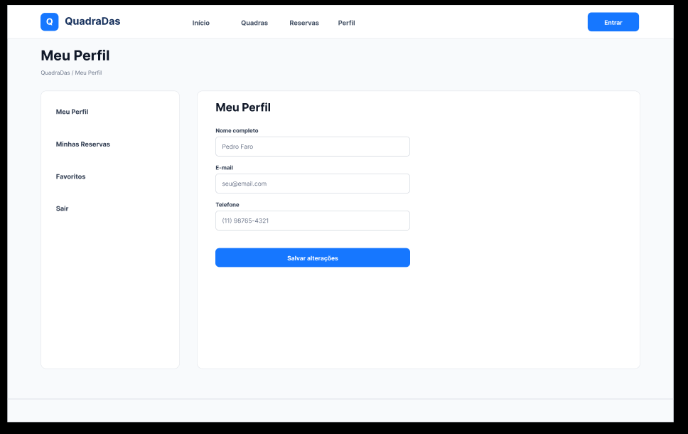
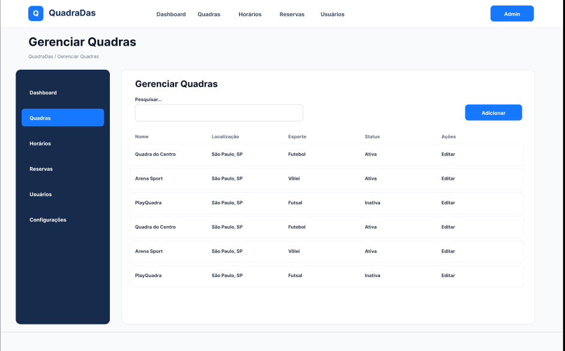
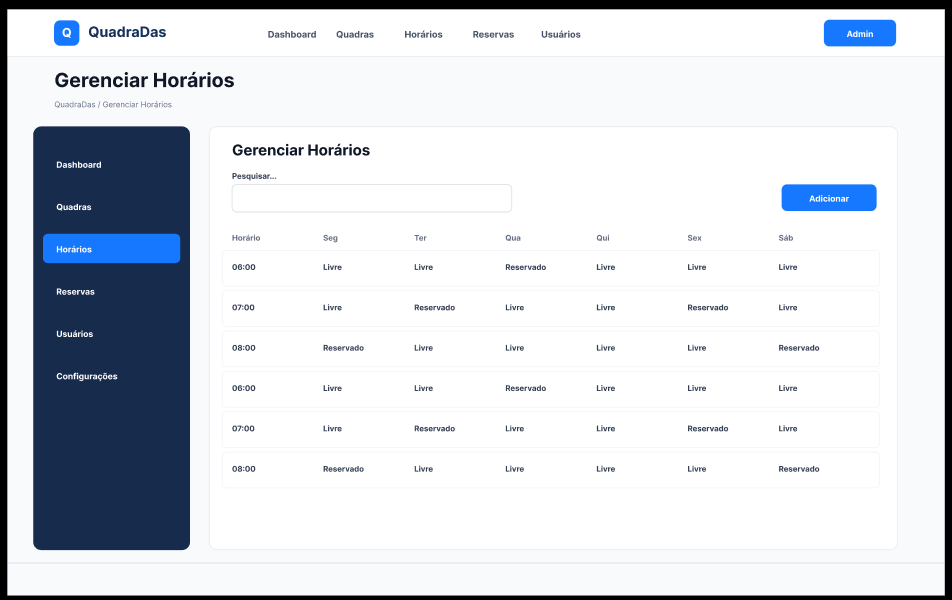
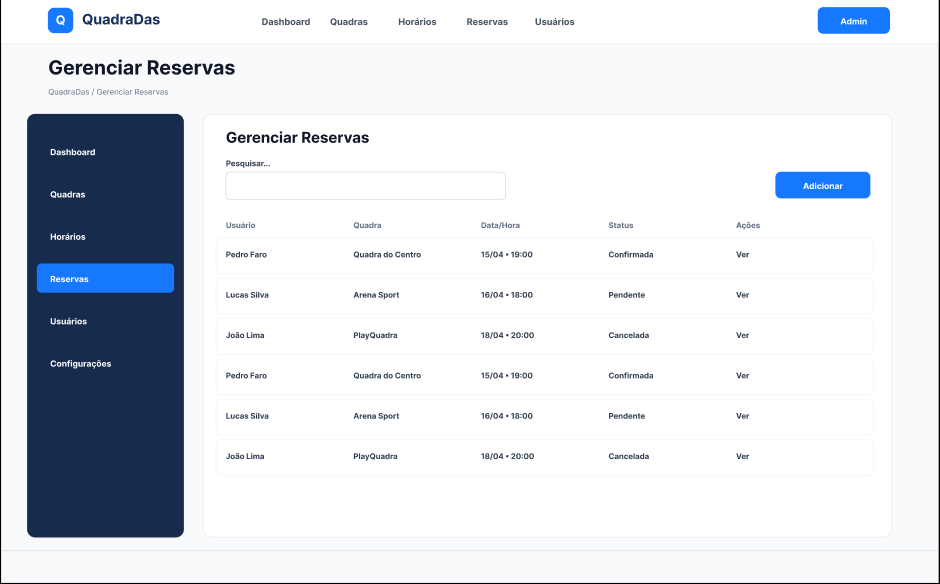
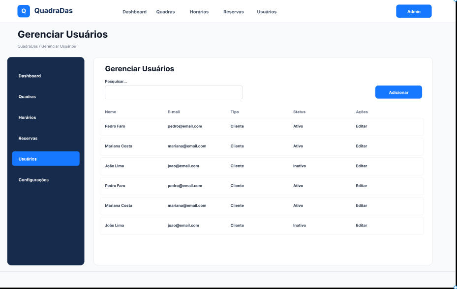
 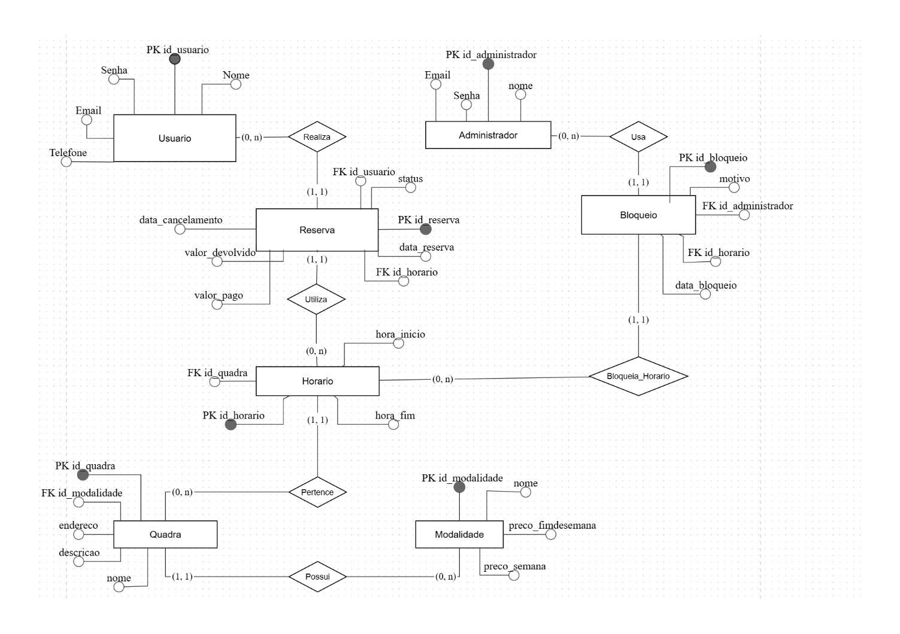